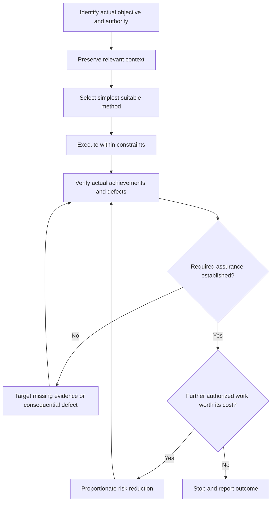

# Engineering Foundational Principles

Version 0.1 — discussion baseline; pending formal adoption.

## Purpose
These principles guide human engineers and AI agents across research, design, planning, implementation, testing, review, orchestration and lifecycle management. They are intentionally independent of MAESTRO Lite, RAIL, a particular model or a particular programming language. The objective is valuable engineering outcomes with appropriate assurance, not maximizing engineering activity.

## The six principles

| ID | Principle | Authoritative draft |
| --- | --- | --- |
| F01 | Deterministic first | [01-deterministic-first.md](01-deterministic-first.md) |
| F02 | Context continuity | [02-context-continuity.md](02-context-continuity.md) |
| F03 | Independent verification | [03-independent-verification.md](03-independent-verification.md) |
| F04 | Evidence-driven evaluation | [04-evidence-driven-evaluation.md](04-evidence-driven-evaluation.md) |
| F05 | Risk-based prioritization | [05-risk-based-prioritization.md](05-risk-based-prioritization.md) |
| F06 | Sufficient quality over maximum quality | [06-sufficient-quality.md](06-sufficient-quality.md) |

## How they work together

Mandatory constraints apply throughout. The diagram is conceptual; a blocked or exhausted task must pause or report its actual state, not loop indefinitely.

## Application in MAESTRO Lite

| Component | Application |
| --- | --- |
| Methodology templates | Maintain the objective, use appropriate session arrangements and select task-specific assurance |
| MAESTRO Lite | Coordinate authorized task boundaries and evidence, without micromanaging every action |
| RAIL | Enforce critical resource boundaries, preserve work and maintain authoritative state |
| Evaluation | Report demonstrated achievements, localized defects and uncertainty; select checks proportionately |
| Human owner | Authorize scope and resolve significant trade-offs; decide policy and exceptions where needed |

## Adoption and maintenance

Use this catalog as a shared reference, not another mandatory process. Load the index as a short orientation and read the specific principle when relevant. Keep one authoritative copy and link to it from methodology files rather than copying the text into every prompt. In the future, approved concrete rules and automated checks may reference the principles. This catalog does not itself grant permission to build, delete, publish, expand scope or alter existing MAESTRO/RAIL documents. Where existing instructions conflict, surface the conflict instead of silently rewriting them.

The P1–P4 descriptions, objective precedence and stopping policy are proposed conventions. They require task-specific interpretation and owner approval before being treated as binding acceptance policy. No universal risk threshold, test quota, review count or model assignment is prescribed.

## Evidence and research foundations

The six principles synthesize our discussion and the supplied historical incident catalog (598 records, 479 reconciled primary labels and 119 disputed labels). The dataset is failure-only, clustered by project/source, and not a controlled benchmark. Incident IDs in individual principles refer to the supplied catalogs; original primary artifacts have not been independently inspected here. The catalog is not embedded or duplicated in this package.

Selected background reading from our earlier research:

- ISTQB Certified Tester Foundation Level: https://www.istqb.org/certifications/certified-tester-foundation-level-ctfl-v4-0/
- NIST SP 800-218, Secure Software Development Framework v1.1: https://doi.org/10.6028/NIST.SP.800-218
- Barr et al., The Oracle Problem in Software Testing: https://doi.org/10.1109/TSE.2014.2372785
- Anthropic, Building Effective Agents: https://www.anthropic.com/research/building-effective-agents
- OpenAI, Harness Engineering: https://openai.com/index/harness-engineering/

These references provide background, not a claim of compliance or proof of the proposed synthesis. The objective hierarchy borrows the ideas of lexicographic prioritization and satisficing. No new systematic literature review or experimental evaluation is claimed.

## Format

EJJ MD v1 standards-entry envelope; the body carries explanatory design guidance. `severity: should` and advisory human review indicate draft principles, not enforced runtime policy. The schema has no dedicated foundational-principles document kind, so the index also uses `principle`. No hooks are introduced by this catalog.
