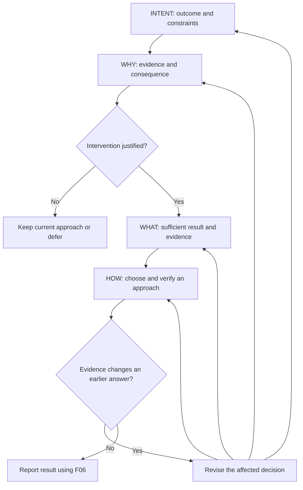

# Engineering Foundations

Version 0.3 — engineering guidance organized around 守時、節事、持盈.

## Intent

Deliver useful, demonstrated outcomes with effort a solo engineer can sustain. Protect the working computer, data, active sessions and valid work. Keep the purpose coherent while changing methods when evidence justifies a better approach.

These foundations guide humans and AI agents. The three governing principles below establish direction; F01–F07 explain their engineering application. The English operational meanings and numbered explanations define the intended behavior. The Chinese names provide inspiration, not additional unstated requirements.

**Attribution:** this project selects 守時、節事、持盈 from ideas attributed to 范蠡 in [國語·越語下](https://zh.wikisource.org/wiki/國語/卷21) and adapts them to engineering. The text explicitly groups 持盈、定傾、節事; 守時 appears nearby. Our selection and engineering meanings are modern interpretations, not a literal translation or a claim that the historical text proves the method works.

## Establish intent before choosing a solution

Use answers already established in the task or authoritative project context. Complete only the missing information that changes the decision; a routine task does not need a new planning document.

| Question | Required distinction |
| --- | --- |
| **INTENT — What are we trying to achieve and preserve?** | State the desired outcome, relevant constraints and priority when goals compete. A preferred technology is not the outcome. |
| **WHY — Why intervene now?** | Identify the observed problem or credible consequence, the cost of leaving it alone, and what existing capabilities already cover. Keeping the current approach is a valid conclusion. |
| **WHAT — What is sufficient?** | State the required behavior, scope, exclusions and evidence needed to judge completion. |
| **HOW — How will we deliver it?** | Choose the smallest sufficient approach, including reuse, composition, adaptation or justified new construction. |

New evidence may change an earlier answer. Revise the affected decision and dependent work; preserve decisions that remain valid.

## S01 — 守時: choose for present conditions

**Decision:** choose an approach that serves the intent under current conditions; reconsider it when relevant evidence changes.

1. **S01.1 — Anchor the decision in intent.** Reuse the agreed outcome and constraints before comparing tools or plans. If two options optimize different goals, compare them against that shared intent; do not silently choose a new goal.
2. **S01.2 — Use current, relevant evidence.** Check the assumptions that determine the choice: available capability, actual failure, operating conditions and cost. Distinguish observed behavior from a report, an inference or an unknown using F04.
3. **S01.3 — Keep the solution open.** A request to solve a problem does not itself require a particular model, algorithm, language or architecture. Compare suitable existing approaches; implement a specified technology when it is an actual task constraint.
4. **S01.4 — Reconsider on a meaningful change.** A changed requirement, verified tool capability, recurring failure or material cost change can reopen the affected decision. Record what changed and which decision it affects; do not restart unrelated planning.
5. **S01.5 — Treat forecasts as scenarios.** A possible future reduction in harness code is a reason to keep replacement feasible, not proof that current safeguards are unnecessary. Simplify or retire a mechanism only after its required guarantees remain covered and the change is authorized; apply S03 and F03.

## S02 — 節事: do the least sufficient work

**Decision:** spend effort on the smallest intervention that satisfies the intent and required assurance.

1. **S02.1 — Ask what can be omitted.** When deciding whether to add a capability, consider keeping the current approach, using an existing capability, composing tools, and building only a justified gap. Stop comparing once the decision has sufficient support.
2. **S02.2 — Prioritize demonstrated need.** Prefer recurring, consequential problems with usable evidence. A rare but credible severe or irreversible failure can justify a safeguard without deliberately reproducing the damage. Describe that rationale separately from measured frequency.
3. **S02.3 — Count the full cost.** Consider engineering time, model input and output, execution resources, integration, maintenance and delayed useful work. A small adapter can be worthwhile when it reduces the total burden; fewer lines of code alone do not establish lower cost.
4. **S02.4 — Gather evidence for a decision.** Before another search, experiment or review, name the unresolved question and how its answer could change the choice. Reuse available evidence and choose a bounded, safe check. Stop discretionary investigation when it no longer changes the decision.
5. **S02.5 — Stop at sufficient quality.** Deliver the agreed outcome and required assurance, then stop optional work whose benefit does not justify its cost. Budget exhaustion does not convert missing required evidence into success; use the completion states in F06.

## S03 — 持盈: preserve useful value and capacity

**Decision:** preserve valid achievements and the ability to continue working; change the implementation when that better preserves the outcome.

1. **S03.1 — Protect the working environment.** Do not reproduce a failure by putting the working computer, valuable data or active sessions at credible risk of loss or interruption. Use existing evidence or a bounded disposable test. Before resource-intensive work, establish resource limits and stop conditions; if these cannot be established, leave that experiment blocked.
2. **S03.2 — Preserve valid work.** Identify the affected behavior or artifact and make the targeted correction. Retain verified results that remain relevant to the changed revision; do not discard the entire result because one part failed.
3. **S03.3 — Preserve intent and decisions.** Keep the main goal, current task, constraints, accepted decisions and authoritative source visible. Reuse existing authorization. Update obsolete decisions explicitly rather than preserving them as permanent instructions.
4. **S03.4 — Preserve demonstrated guarantees.** Bind results to the actual candidate and check. Verify the guarantees affected by a change, including the composition of reused tools. Model agreement, a clean Git diff or a green test count alone does not establish every promised property.
5. **S03.5 — Retire what no longer earns its cost.** Preserve the useful behavior, evidence and any needed recovery path when removing obsolete scaffolding. Existing code is not a reason to keep a mechanism, and expected future capability is not a reason to remove it prematurely.

## Apply the seven engineering principles

The existing F01–F07 IDs and file paths remain stable. Each is an application of the governing principles, not a competing goal.

| ID | Engineering principle | Main connection |
| --- | --- | --- |
| [F01](01-deterministic-first.md) | Deterministic first | 節事: use the simplest reliable mechanism; 持盈: verify its oracle. |
| [F02](02-context-continuity.md) | Context continuity | 持盈: retain the overall intent; 守時: update stale decisions. |
| [F03](03-independent-verification.md) | Independent verification | 持盈: establish required guarantees; 節事: match checks to consequence. |
| [F04](04-evidence-driven-evaluation.md) | Evidence-driven evaluation | 守時: act on relevant evidence; 持盈: preserve demonstrated achievements. |
| [F05](05-risk-based-prioritization.md) | Risk-based prioritization | 節事: choose worthwhile work; 持盈: protect against credible severe loss. |
| [F06](06-sufficient-quality.md) | Sufficient quality | 節事: stop optional expansion; 持盈: retain required assurance. |
| [F07](07-composition-before-construction.md) | Composition before construction | All three: use current capabilities, justify new work and preserve required behavior. |

## Resolve ambiguity and conflict

A **required criterion** comes from applicable instructions, accepted task requirements or an established safety boundary. An AI preference or newly suggested improvement is not automatically required. A **material uncertainty** is one whose answer could change authority, the intended outcome, a required criterion, exposure to loss or interruption, or the choice between approaches.

Apply the following decision order. Required constraints, the primary outcome and required assurance must all be satisfied for completion; the order is not permission to skip any of them.

| Order | Agent behavior |
| --- | --- |
| 1. Authority and boundaries | Follow the applicable instruction hierarchy, authorized scope and established safety boundaries. This catalog grants no additional permission. |
| 2. Intent and outcome | Use the current accepted objective and priorities. Resolve lower-level preferences in its favor within those boundaries. |
| 3. Required evidence | Establish the applicable acceptance criteria against the actual result. Missing required evidence remains missing. |
| 4. Discretionary effort | Choose additional work by expected benefit and full cost, then stop when it is not worthwhile. |

For a missing fact, first inspect an available source or use a safe, bounded check. Choose among already-authorized approaches when the choice preserves the intended outcome, scope, required criteria, safety boundaries and agreed cost or resource limits. A fact changing which approach is preferred does not by itself require owner approval. For a reversible implementation choice within those boundaries, choose a reasonable approach and state an assumption when it affects the result.

If a remaining ambiguity or conflict prevents a compliant decision within existing authority, pause only the affected action, identify the competing interpretations or requirements, and ask the owner for the missing decision. Continue unaffected authorized work.

Do not seek approval again for an action already authorized in the task. Do not invent an exception, silently waive a requirement, or turn optional advice into a new gate.

## Use and maintenance

Read this index for direction and the relevant F document for the decision at hand. Link to the authoritative source instead of maintaining copies in every prompt. The catalog specifies guidance, not a new engine, hook, mandatory meeting, universal test quota or required review count.

The existing EJJ MD v1 envelope and advisory metadata remain. A consuming task supplies its actual authority and acceptance policy. Prose defines the rules; diagrams summarize them. If they disagree, treat that as a documentation defect and apply the applicable instructions while resolving it.

[Traceability](TRACEABILITY.md) maps all numbered explanations to the prior foundations and this discussion. [Rewrite review](reviews/2026-11-28-rewrite.md) records the requested three review rounds. These are records of this revision, not additional paperwork required for every task.

