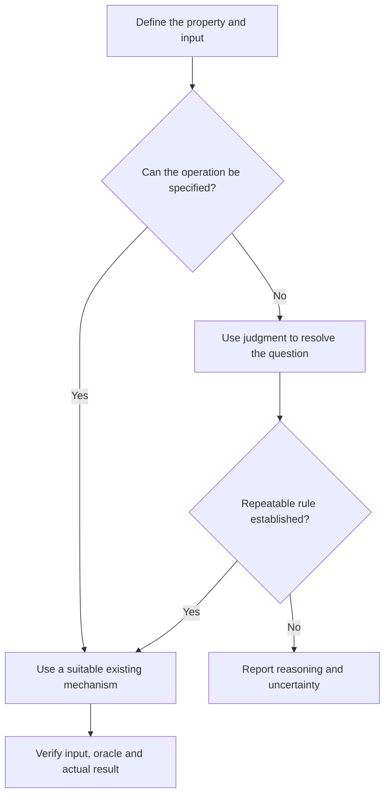

# F01 — Deterministic first

Version 0.3. Part of the [foundations catalog](00-engineering-foundations.md).

## Principle

Use an existing, reliable deterministic mechanism when the operation and its expected result can be specified. Use AI judgment for interpretation, synthesis and decisions that require it.

**Connection:** 節事 reduces avoidable model work; 持盈 requires the mechanism to check the correct property.

## Explanation and action

1. **F01.1 — Name the property first.** Identify what must be calculated, transformed or verified and the input it applies to. A check is useful only if its result answers the task's actual question.
2. **F01.2 — Use an existing mechanism.** Read the clock, compare Git identities, parse structured data or run an available command when that reliably provides the answer. Do not build a new checker merely to replace a sufficient command.
3. **F01.3 — Use judgment where needed.** Let the model interpret an unclear goal or compare designs. Once a repeatable rule is established, use a suitable deterministic operation for that part; do not force the whole reasoning process into scripts.
4. **F01.4 — Validate the rule and input.** Confirm that the expected result, input identity and exercised path match the intended behavior. Repeatability cannot correct a mistaken formula, stale input or incomplete oracle. Here, an oracle means the basis used to decide what the correct result should be.
5. **F01.5 — Report observations.** Keep command results and relevant identities distinguishable from the agent's explanation. A statement that a check was planned or run is not its observed outcome.
6. **F01.6 — Add enforcement for a reason.** Clear instructions can suffice for low-impact behavior. Add validation or enforcement when recurring failures, consequence or cost justify it. Establish a necessary boundary before a high-consequence action; do not wait for damage to prove the need.

## Examples

| Question | Suitable response |
| --- | --- |
| Which revision was tested? | Read and compare revision identities. |
| How many records satisfy a predicate? | Compute using the stated predicate and dataset. |
| Which approach best serves the intent? | Compare evidence and trade-offs using judgment. |

These examples select mechanisms; they do not establish that a particular implementation is correct.

**Review question:** does the mechanism establish the promised property with less effort than the alternatives?

**Basis:** [F01 traceability](TRACEABILITY.md#f01).

