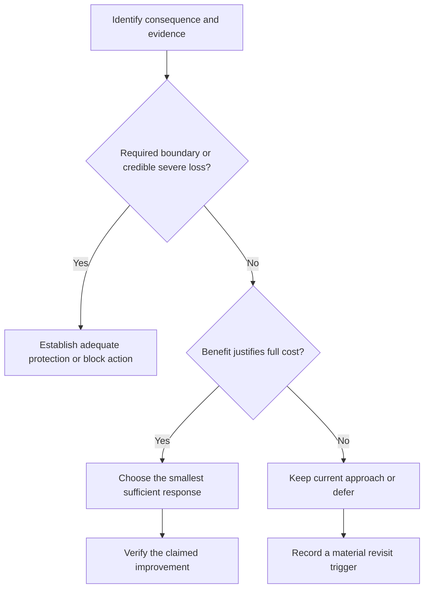

# F05 — Risk-based prioritization

Version 0.3. Part of the [foundations catalog](00-engineering-foundations.md).

## Principle

Choose engineering work by the consequences it can prevent or the value it can deliver, using available evidence and the full cost of intervention.

**Connection:** 節事 directs finite effort; 持盈 retains necessary protection against credible serious loss.

## Explanation and action

1. **F05.1 — State the consequence of doing nothing.** Identify the affected outcome, plausible failure and what would be lost, delayed or repeated. Distinguish the actual need from an assumed solution; preserving source history is different from keeping a machine continuously available.
2. **F05.2 — Establish recurrence and exposure honestly.** Prefer observed, recurring consequential problems for discretionary improvement. Use existing records or a safe bounded reproduction when it answers a remaining question. Report unknown frequency or incomplete coverage instead of inventing likelihood.
3. **F05.3 — Compare the least expensive sufficient responses.** Consider current protections, omission, prevention, detection and recovery, including existing tools. A costly prevention mechanism is not automatically better than an adequate recovery path.
4. **F05.4 — Compare full cost over the same horizon.** Include implementation, model usage, runtime resources, maintenance and opportunity cost. Use probability multiplied by consequence only when the inputs and units are defensible; otherwise state the qualitative consequence, uncertainty and cost directly.
5. **F05.5 — Preserve required boundaries and credible severe-risk safeguards.** Rarity is not permission to ignore an irreversible or high-consequence failure. Use the least costly adequate safeguard or leave the affected action blocked if its required protection is unavailable. A speculative concern without a credible mechanism is not automatically a new requirement.
6. **F05.6 — Record material deferral briefly.** For a consequential issue left unresolved, state the reason, who has authority for that decision and a concrete trigger for revisiting it. Existing task notes are sufficient; trivial preferences do not need a separate risk register.

## Example: recovery before infrastructure

If the need is to recover committed source after losing a workstation, a verified copy in a separate Git remote may cover that need. It does not preserve uncommitted work, ignored files, unrelated data or machine availability. First identify what actually needs recovery; add protection only for the remaining requirement. This example does not mandate Git or assert that it replaces every backup system.

**Review question:** what useful consequence does this intervention change, and is there a cheaper sufficient response?

**Basis:** [F05 traceability](TRACEABILITY.md#f05).

