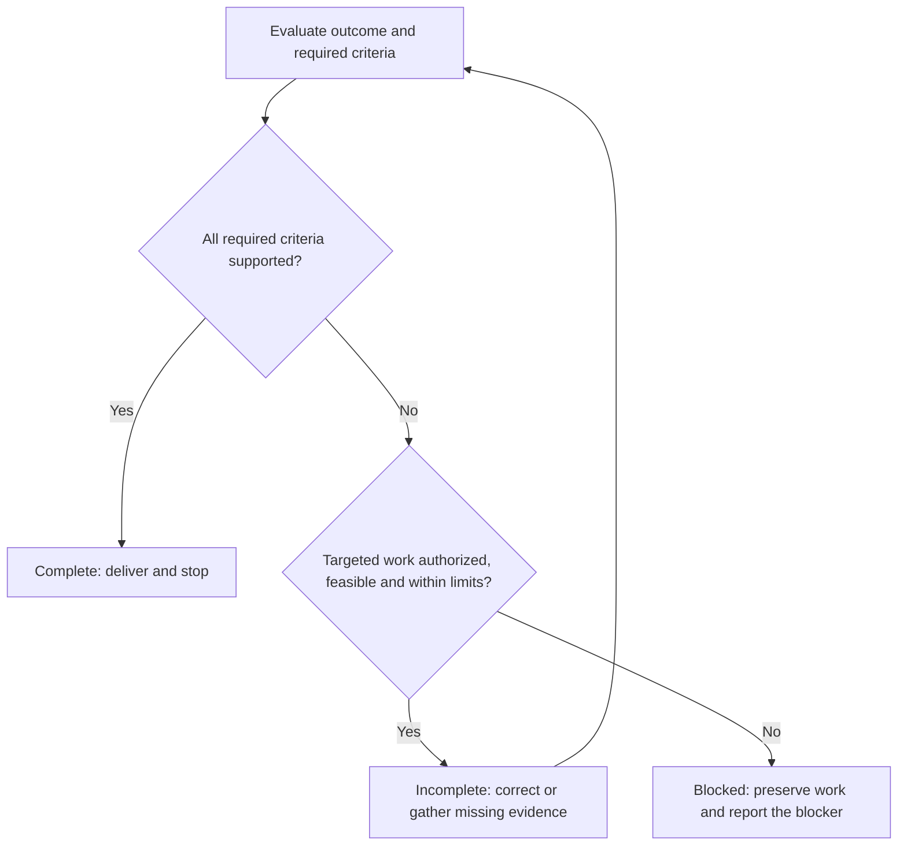

# F06 — Sufficient quality

Version 0.3. Part of the [foundations catalog](00-engineering-foundations.md).

## Principle

Complete the agreed outcome with its required assurance. Stop discretionary work when its expected benefit no longer justifies its cost.

**Connection:** 節事 provides the stopping rule; 持盈 prevents that rule from discarding required guarantees.

## Explanation and action

1. **F06.1 — Reuse or establish the completion criteria.** Identify the requested result, required constraints and evidence needed for acceptance. Separate required criteria, criteria triggered by stated conditions, and optional improvements. Use the existing task context when it already supplies these answers.
2. **F06.2 — Apply the shared precedence.** Follow the [index decision order](00-engineering-foundations.md#resolve-ambiguity-and-conflict). Constraints, outcome and required assurance must all hold. If they cannot be satisfied together, report the conflict and pause the affected action instead of silently weakening one.
3. **F06.3 — Match effort to the promised scope.** A disposable experiment needs evidence for its feasibility claim; an operation affecting valuable data needs its applicable protections even when called a prototype. Do not add production qualification to a small task without a requirement or concrete risk.
4. **F06.4 — Bound discretionary review.** Use the review count or effort limit specified for the task. Before additional work, identify the unresolved criterion or consequential risk it would address. Optional preferences are non-blocking; a reviewer must name a criterion and evidence for a claimed defect.
5. **F06.5 — Correct the affected part.** Preserve valid work, repair confirmed defects and recheck affected criteria and interactions. Do not restart every phase or add another broad review merely because an earlier review found something.
6. **F06.6 — Report the actual completion state.** Use the states below. A finished review budget cannot satisfy missing criteria. Once the task is complete, deliver it and stop; record only residual uncertainty or deferred work that matters to the user's decision.

## Completion states

| State | Condition | Action |
| --- | --- | --- |
| **Complete** | The requested outcome and all applicable required criteria have supporting evidence; no blocking issue remains. | Deliver the result and material limitations. |
| **Incomplete** | Required work, a correction or required evidence is still missing, and authorized feasible work can continue within the task's limits. | Continue that targeted work. |
| **Blocked** | A required condition cannot be established because of conflicting instructions, unavailable access, missing authority, unsafe conditions or an exhausted applicable limit. | Preserve the work and state the specific blocker and needed decision or input. |

Deliberately deferred optional work does not make a completed task incomplete. Removing a required criterion changes the agreement and requires authority to make that change; labeling it optional is not a substitute.

The loop ends at the task's applicable limits. Missing required evidence remains visible when work stops.

**Review question:** which required criterion remains unmet, or what concrete benefit justifies more work?

**Basis:** [F06 traceability](TRACEABILITY.md#f06).

