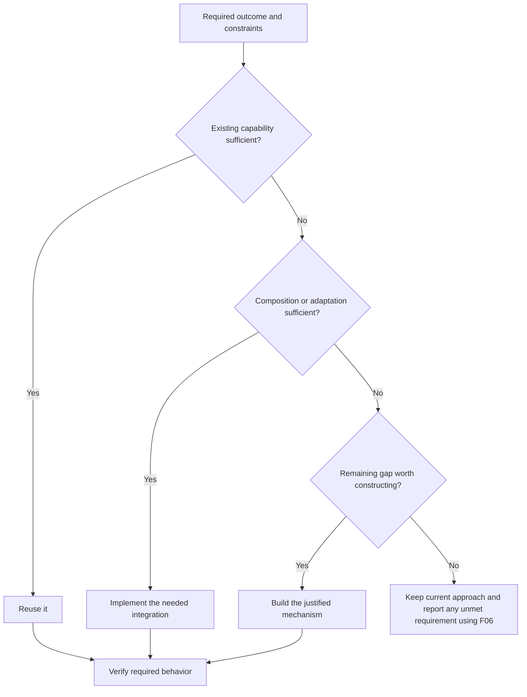

# F07 — Composition before construction

Version 0.3. Part of the [foundations catalog](00-engineering-foundations.md).

## Principle

Use existing capabilities when they sufficiently meet the need. Compose, adapt or extend them when that is worthwhile; construct new mechanisms for justified remaining gaps.

**Connection:** 守時 considers current capabilities; 節事 compares total effort; 持盈 preserves the behavior and guarantees the result must retain.

## Explanation and action

1. **F07.1 — Begin with the outcome.** Identify the required behavior and operating constraints before choosing a product, algorithm or language. Group interacting requirements for design while keeping each required behavior traceable.
2. **F07.2 — Inspect what already exists.** Consider installed tools, operating-system facilities, maintained projects and supported interfaces. Reuse directly, compose, configure, adapt or extend where sufficient. This is a preference for discovery, not a mandatory sequence or fixed number of candidates.
3. **F07.3 — Compare the actual ownership cost.** Assess the relevant capability, compatibility, authority boundaries, licensing obligations, dependency maintenance, resource use and upgrade path. Do not add a dependency solely to reduce line count or reject useful custom work solely because alternatives exist.
4. **F07.4 — Define the necessary integration boundary.** State inputs, outputs, errors and ownership where components interact; include cancellation, state, recovery or enforcement responsibilities when the requirement depends on them. Individually reliable tools do not prove a reliable composition.
5. **F07.5 — Verify the claimed composition.** Use the real components in a safe, bounded check of required behavior and important interface failures. Distinguish a documentation claim, a feasibility demonstration and required acceptance evidence. Reuse existing valid evidence when it covers the actual composition.
6. **F07.6 — Build the justified gap and revisit it when conditions change.** Write only the needed glue or new mechanism, choosing the language for the task. Replace or retire it when evidence shows a cheaper sufficient option, preserving required behavior and applicable recovery needs.

In the diagram, **sufficient** means meeting the required behavior and constraints at a justified full cost, using the comparison in F07.3. Consider known feasible alternatives; an existing tool's functional coverage alone does not rule out a worthwhile adapter. Stop the comparison once there is enough evidence to choose.

## Example: a small tool can be the sufficient answer

EJ reported composing existing Linux tools in Rust to make their inputs and outputs more suitable for coding agents, reducing prompt and return lengths. This is a reported experience, not an independently measured savings claim. It illustrates why this principle permits useful custom integration: the comparison is the total cost of meeting the need, including model usage and maintenance.

Finding a reference can change the chosen approach. It does not require adopting the reference's entire architecture, and it does not automatically mean abandoning the project.

**Review question:** which required capability remains missing, and does owning its implementation justify the full cost?

**Basis:** [F07 traceability](TRACEABILITY.md#f07).

